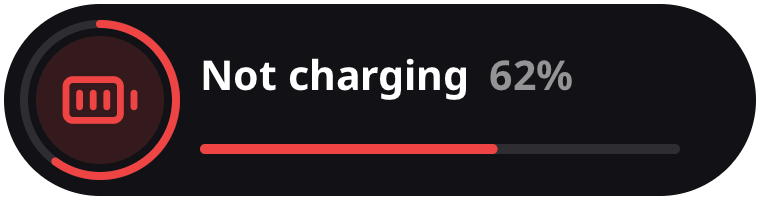
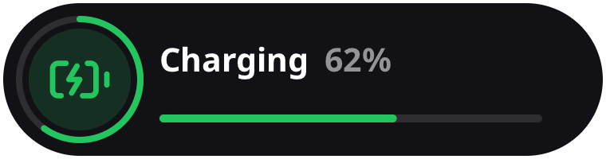

<div align="center">

# Frame Power Alert

A SteamVR overlay that alerts you when your Steam Frame stops charging.





</div>

<div align="center">

[Key Features](#key-features) •
[Pre-Requisites](#pre-requisites) •
[Installation](#installation) •
[Usage](#usage) •
[Configuration](#configuration) •
[Contact & Support](#contact--support) •
[Other Projects](#other-projects) •
[Mentions](#mentions) •
[License](#license)

</div>

<br>
<br>

## Key Features

<ul style="font-size: 16px;">
  <li>🔌 <strong>Charge Monitoring</strong> - Notifies you when the headset stops or resumes charging.</li>
  <li>🪫 <strong>Low Battery Warning</strong> - Warns you before the headset battery runs out.</li>
  <li>👓 <strong>In-Headset Notifications</strong> - Alerts appear in view over any SteamVR app.</li>
  <li>🔔 <strong>Audio Cues</strong> - Each alert has its own sound.</li>
  <li>🔕 <strong>Uninterrupted Play</strong> - Stops Steam's slow charger dialog from pulling you out of VR when you swap power sources.</li>
  <li>🔄 <strong>Auto Updates</strong> - Installs the latest version each time SteamVR starts.</li>
  <li>🚀 <strong>Standalone</strong> - Runs on the Frame itself alongside SteamVR. No PC software required.</li>
</ul>

## Pre-Requisites

- A Steam Frame with SteamVR installed.
- `git`, `g++` and PipeWire's `pw-play` on the Frame.

## Installation

Run on the Frame:

```sh
git clone https://github.com/Duinrahaic/frame-power-alert.git
cd frame-power-alert
./install.sh
```

The alert service starts with SteamVR and restarts automatically after a crash. Each SteamVR start also pulls the
latest version from git and reinstalls it if anything changed.

Steam's slow charger dialog is removed from Steam's UI (`~/.local/share/Steam/steamui/sp.js`, backed up as `sp.js.orig`)
and patched again whenever Steam updates. It takes effect the next time Steam starts. The dialog still opens from the
battery entry in Quick Access.

### Installing from another machine

To install over SSH from a PC instead:

1. Enable SSH on the Frame and make sure you can connect with `ssh steamos@<frame-address>`.
2. Clone the repository on the PC. Running the script needs a POSIX shell with `ssh` and `scp`, such as Git Bash on
   Windows.
3. Run the deploy script, which copies the project to `~/frame-power-alert` on the Frame and runs `install.sh` there:

   ```sh
   FRAME=steamos@<frame-address> ./deploy.sh
   ```

`FRAME` defaults to the SSH host `steamframe`. `FRAME_SSH_OPTS` passes extra options to every `ssh` and `scp` call,
for example `FRAME_SSH_OPTS="-o Port=2222"`. Copies installed this way are not a git checkout, so they don't auto-update;
run `deploy.sh` again to update.

### Uninstall

Run on the Frame:

```sh
systemctl --user disable --now frame-power-alert frame-power-alert-update frame-power-alert-steamui.path
rm ~/.local/bin/frame-power-alert* ~/.config/systemd/user/frame-power-alert*
mv ~/.local/share/Steam/steamui/sp.js.orig ~/.local/share/Steam/steamui/sp.js
```

Then delete the cloned folder (`~/frame-power-alert` if installed from another machine).

## Usage

Run on the Frame:

| Task                 | Command                                           |
| -------------------- | ------------------------------------------------- |
| Play each alert once | `~/.local/bin/frame-power-alert --demo`           |
| Check the service    | `systemctl --user status frame-power-alert`       |
| View logs            | `journalctl --user -u frame-power-alert`          |
| Update now           | `systemctl --user start frame-power-alert-update` |
| View update logs     | `journalctl --user -u frame-power-alert-update`   |

To re-render the images in `docs/` after changing the design, run `./install.sh preview`, or `./deploy.sh preview`
from another machine.

## Configuration

### Default alerts

| Alert        | Trigger                                     | Shown for |
| ------------ | ------------------------------------------- | --------- |
| Not charging | USB-C input goes offline or drops below 9 V | 10 s      |
| Charging     | USB-C input returns at 9 V or above         | 4 s       |
| Low battery  | Battery drops to 25% or below               | 10 s      |

Alerts fire only when the state changes, never for the state at startup.

### Where to change them

| Setting                                  | Location                       |
| ---------------------------------------- | ------------------------------ |
| Thresholds, timings, size and placement  | Constants at the top of `src/main.cpp` |
| Colors, labels and icons                 | `styleFor` in `src/pill.h`     |
| Chime notes                              | `main` in `src/main.cpp`       |

Run `./install.sh` (or `./deploy.sh`) again after making changes.

## Contact & Support

For additional support, please consider joining my Discord server [here](https://discord.gg/aZQfy6H9fA).

[](https://ko-fi.com/Duinrahaic)
[](https://x.com/Duinrahaic)
[](https://bsky.app/profile/duinrahaic.app)
[](https://github.com/Duinrahaic)

## Other Projects

- [FitOSC](https://github.com/Duinrahaic/FitOSC) - An Avatar Treadmill Controller for VRChat.
- [VRCDollyManager](https://github.com/Duinrahaic/VRCDollyManager) - A Dolly Manager for VRChat.
- [VRCPictureToClipboard](https://github.com/Duinrahaic/VRCPictureToClipboard) - A tool to copy the latest picture from VRChat to your clipboard.

## Mentions

Frame Power Alert is built on the shoulders of these open-source libraries:

- [OpenVR SDK](https://github.com/ValveSoftware/openvr) - Valve's VR hardware access SDK.
- [stb](https://github.com/nothings/stb) - Single-file libraries for font rendering and PNG output.
- [Lucide Icons](https://github.com/lucide-icons/lucide) - Open-source icon toolkit.

## License

Frame Power Alert is licensed under the [MIT License](LICENSE). Modify and distribute as needed.

---
